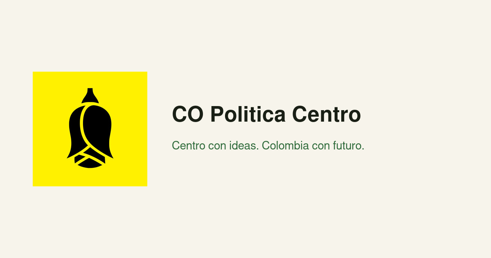

<p align="center">
  <a href="README.md">Español</a> · <a href="README.en.md">English</a>
</p>

<h1 align="center">Portal</h1>

<p align="center">
  
</p>

<p align="center">Portal of the center movement in Colombia.</p>

Public site at [web-portal-co-politica.vercel.app](https://web-portal-co-politica.vercel.app). Copy comes from `src/content/site.ts`. The community is on Discord.

<p align="center">
  <a href="https://github.com/CO-Politica-Centro/web-portal/actions/workflows/ci.yml"></a>
</p>

<p align="center">
  <a href="https://skillicons.dev">
    <picture>
      <source media="(prefers-color-scheme: dark)" srcset="https://skillicons.dev/icons?i=nextjs,react,ts,tailwind,pnpm,githubactions&theme=dark&perline=6">
      <source media="(prefers-color-scheme: light)" srcset="https://skillicons.dev/icons?i=nextjs,react,ts,tailwind,pnpm,githubactions&theme=light&perline=6">
      
    </picture>
  </a>
</p>

## ✨ Features

- Home, proposals, team, and contact.
- Motion with GSAP and respect for reduced motion.
- CI and `pnpm test`.

> [!NOTE]
> The movement copy is edited in `src/content/site.ts`, not scattered through the components.

## 🛠️ Tech stack

- **Next.js, React, and Tailwind** — the portal.
- **GSAP** — scroll. It has no icon in the grid.
- **pnpm 11.1.1** — Node 22 or newer.

## 🚀 Quick start

```bash
pnpm install
cp .env.example .env.local
pnpm dev
```

> [!IMPORTANT]
> `pnpm run ci` runs lint, types, format, tests, and build.

## 📖 Usage

The site Discord invite is https://discord.gg/VKjgAbDDvC.

> [!TIP]
> With `prefers-reduced-motion` there are no reveals or parallax. Try the portal that way too.

## 🤝 Contributing

Repository of [CO Politica Centro](https://github.com/CO-Politica-Centro).

> [!WARNING]
> Do not commit `.env.local`.

## 📄 License

This repository does not include a license file.
